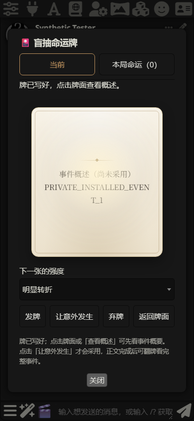

# 命运牌：推理预算与旧牌组补写

本次处理“能选中牌，但没有概述、无法翻面”的实际报告。修改限于独立插件与其请求适配层，宿主核心未改；命运之牌为 **1.3.4**，好感度记忆为 **1.1.4**。好感度只随包更新共享适配层，计分和整理预算不变。

## 根因与修复

使用当前模型连接、完全合成的场景，旧 1024 token 请求返回 HTTP 200，却因长度限制结束：1024 个输出 token 中 1021 个是思考，正文为空。同场景提高到 8192 上限后返回有效事件，实际使用 1952 token。此前的合成提供方测试没有模拟这一行为，因此未发现这个真实失败原因。

- 命运牌事件请求最多预留 8192 token，已知上下文较小时限制为其一半。正文回复长度不变，好感度与普通独立请求仍最多 2048 token。旧好感度插件先初始化共享运行层时，新命运牌仍使用自己的新版预算适配器。
- 只有牌名的旧三张候选牌，打开面板后一次补写三张事件；手动发牌也接着补写。同一牌组不会在关闭重开面板时无限自动重试，失败保留原牌并提供“补写概述”。完整牌组加载、同强度选牌不调用模型。
- 补写保留原牌组 ID、牌名、手中旧牌、换牌次数与保底状态。聊天切换、停止、正常生成开始或牌组被替换时，过期结果不能覆盖当前状态；补写请求有 120 秒超时。
- 普通回复可以补齐现有空牌组，不再因为“已有 offer”永久跳过。已完整的牌组仍受保护；采用当前牌后的同一条回复继续准备下一组。
- 三张小牌同步显示实际事件开头；选牌成功立即显示概述。相同牌组 ID 的补写也会更新 DOM，进度与错误移至卡牌上方。
- 面板操作绑定原聊天与面板；发牌保存期间关闭窗口，不继续发起补写。异步期间改变强度或切换聊天，不会将新状态套到旧操作上；旧错误不写入重新打开的窗口。

## 验证

仅运行相关检查，没有运行全仓测试。全部用例的成功、失败、取消和跳过情况以 [validation.json](validation.json) 为准。

```powershell
$related = Get-ChildItem tests/director-fate*.test.mjs,tests/plugin-*.test.mjs,tests/standalone-plugin-package.test.mjs
node --test $related.FullName
node node_modules/eslint/bin/eslint.js public/scripts/extensions/director/fate.js public/scripts/extensions/director/fate-ui.js public/scripts/plugin-runtime/requests.js public/scripts/plugin-runtime/runtime.js tests/director-fate*.test.mjs tests/plugin-requests.test.mjs tests/plugin-runtime.test.mjs
python -m py_compile tests/browser-standalone-plugins.py
git -c core.whitespace=cr-at-eol diff --check
```

单元及打包相关测试 **371/371**，无失败、取消或跳过。新增失败用例先复现旧预算、旧面板归属和同 ID 概述不刷新的问题，再验证修复。

浏览器用实际构建 ZIP 分别安装到官方 1.19.0 与改进版 1.19.0 的隔离夹具，使用合成聊天与模型服务。下列命令每个宿主各跑一次；`<host>`、`<node>`、`<result.json>` 均为运行时参数，不是发布包内容：

```text
python tests/browser-standalone-plugins.py --host-root <host> --node <node> --fate-repair-only --output <result.json>
python tests/browser-standalone-plugins.py --host-root <host> --node <node> --piggyback-only --output <result.json>
python tests/browser-standalone-plugins.py --host-root <host> --node <node> --fate-pick-only --output <result.json>
python tests/browser-standalone-plugins.py --host-root <host> --node <node> --fate-reveal-only --output <result.json>
```

覆盖旧牌组补写、重载零请求选牌、390px 触摸操作、慢请求中关闭重开与滚动、采用后揭晓、键盘操作、流式/非流式及下一轮备牌。揭晓夹具首次在原生保存尚未完成时检查可点击状态，两个宿主均失败；已改为等待保存完成、控件解锁后检查，失败运行保留并在验证清单中单列。

真实模型额外使用最终包内控制器和请求构建器，向当前连接发送合成场景。**一次请求写好三张事件，12.553 秒，使用 1707 token（其中思考 1329）**；序列化后重新加载并选牌成功，额外请求 **0**，概述存在。这个探针只在内存里保存合成状态，没有读取或修改用户聊天。只保留计数、耗时与布尔结果，见 [real-model.json](real-model.json)。

手机截图来自 390px 触摸模拟器，展示合成事件，不是用户聊天：



## 发布完整性与边界

| 包 | SHA-256 |
| --- | --- |
| st-director-fate-cards-1.3.4.zip | `6765078b69c4291974187cd2a8a26c55f798269b7bea6d67c804af0a09226cdd` |
| st-affinity-memory-1.1.4.zip | `874bc73d68a10f74c4d4c80759dc7cb9ed714ed02f9a1f54f390850540c18435` |

每份浏览器结果同时记录安装包与运行脚本哈希；验证的是上述 ZIP。源码提交后的 CI 结果应以该提交的实际 Checks 为准，不能用历史运行替代。

“随正文备牌”仍依赖模型按要求输出完整三张事件，并共用正文预算；不能保证每一轮都免等待。失败时会显示明确进度或重试入口。8192 是输出上限而非最低消耗，较小上下文仍可能不足。真实模型探针只覆盖当前连接与合成场景，实体手机、其他提供方及用户具体故事未验收。
